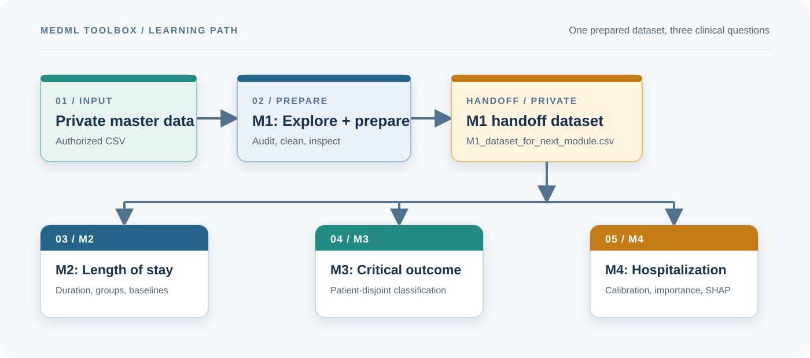

# MedML Toolbox

### A guided, evidence-first machine-learning curriculum for emergency-department electronic health records (EHR)

[](https://github.com/waziz786/MedML-toolbox/actions/workflows/validate.yml)

**Start here:** [choose a setup route](docs/local_setup.md) | [use Colab](docs/colab.md) | [follow the teaching sequence](docs/teaching_sequence.md) | [read the data policy](docs/data_access.md)

MedML Toolbox is a student-facing curriculum for exploring emergency-department data and building interpretable machine-learning baselines. Each module has a notebook, a presentation, and a full lecture recording so students can choose a read, watch, or run-first route.

> **Privacy first:** The authorized MIMIC-IV-derived dataset, assignment datasets, and generated row-level outputs stay outside GitHub. This repository contains learning materials and reproducibility guidance only.

**Watch online:** [Open the tested browser player](https://raw.githack.com/waziz786/MedML-toolbox/main/site/index.html)

## A simple route through the course

1. Read [data access and privacy guidance](docs/data_access.md).
2. Choose [local execution](docs/local_setup.md) or [Google Colab](docs/colab.md).
3. Work through M1, M2, M3, and M4 in order.
4. For each module, preview the deck, watch the recording, then run the notebook.
5. Continue to the [Assignment 2 guide](docs/assignment-2.md) after M4.



M1 prepares the shared private handoff. M2, M3, and M4 reuse that handoff to study different outcomes, evaluation strategies, and explanation methods.

## Curriculum at a glance

| Module | Focus | Watch | Notebook | Slides |
| --- | --- | --- | --- | --- |
| **M1** | ED exploration and preparation | [Play online](https://waziz786.github.io/MedML-toolbox/#m1) | [Open in GitHub](notebooks/01_M1_MIMIC_IV_ED_Dataset_Exploration.ipynb) · [Colab](https://colab.research.google.com/github/waziz786/MedML-toolbox/blob/main/notebooks/01_M1_MIMIC_IV_ED_Dataset_Exploration.ipynb) | [PDF](presentations/pdf/01_M1_EHR_MIMIC_IV_ED_Notebook_Overview.pdf) · [PPTX](presentations/pptx/01_M1_EHR_MIMIC_IV_ED_Notebook_Overview.pptx) |
| **M2** | Emergency-department length of stay | [Play online](https://waziz786.github.io/MedML-toolbox/#m2) | [Open in GitHub](notebooks/02_M2_ED_Length_of_Stay_Analysis.ipynb) · [Colab](https://colab.research.google.com/github/waziz786/MedML-toolbox/blob/main/notebooks/02_M2_ED_Length_of_Stay_Analysis.ipynb) | [PDF](presentations/pdf/02_M2_ED_Length_of_Stay_Overview.pdf) · [PPTX](presentations/pptx/02_M2_ED_Length_of_Stay_Overview.pptx) |
| **M3** | Critical clinical outcome | [Play online](https://waziz786.github.io/MedML-toolbox/#m3) | [Open in GitHub](notebooks/03_M3_Critical_Outcome_Analysis.ipynb) · [Colab](https://colab.research.google.com/github/waziz786/MedML-toolbox/blob/main/notebooks/03_M3_Critical_Outcome_Analysis.ipynb) | [PDF](presentations/pdf/03_M3_Critical_Outcome_Analysis_Current_Evidence.pdf) · [PPTX](presentations/pptx/03_M3_Critical_Outcome_Analysis_Current_Evidence.pptx) |
| **M4** | Hospitalization and explainability | [Play online](https://waziz786.github.io/MedML-toolbox/#m4) | [Open in GitHub](notebooks/04_M4_Hospitalization_Analysis.ipynb) · [Colab](https://colab.research.google.com/github/waziz786/MedML-toolbox/blob/main/notebooks/04_M4_Hospitalization_Analysis.ipynb) | [PDF](presentations/pdf/04_M4_Hospitalization_Analysis_Current_Evidence.pdf) · [PPTX](presentations/pptx/04_M4_Hospitalization_Analysis_Current_Evidence.pptx) |

### Recommended module loop

**Preview -> watch -> run -> reflect**

- **Preview:** Identify the question, target, unit of observation, and expected handoff.
- **Watch:** Use the recording to see the reasoning behind the analysis choices.
- **Run:** Execute the notebook with authorized data and keep generated outputs private.
- **Reflect:** Compare metrics, thresholds, limitations, and possible leakage instead of selecting a model from one score.

See the [full teaching sequence](docs/teaching_sequence.md) for classroom pacing.

## Assignment 2: ICU prediction project

Assignment 2 is a separate applied project with its own briefing and prediction windows.

- [Assignment 2 guide](docs/assignment-2.md)
- [Briefing deck - PDF](assignments/assignment-2/ICU_Prediction_Assignment_Briefing.pdf)
- [Briefing deck - editable PPTX](assignments/assignment-2/ICU_Prediction_Assignment_Briefing.pptx)
- [Play the assignment briefing online](https://github.com/waziz786/MedML-toolbox/blob/main/recordings/README.md#assignment-2-briefing)

The windowed ICU CSV files are row-level clinical data and are distributed through the approved private course channel. They are intentionally not committed to this public repository.

## Choose your setup route

| Route | Best for | First step |
| --- | --- | --- |
| **Local** | Full control over the environment and private files | [Create an environment](docs/local_setup.md) |
| **Google Colab** | Fast setup or managed compute | [Mount private Drive data](docs/colab.md) |
| **Teaching mode** | Guided classroom discussion | [Use the sequence guide](docs/teaching_sequence.md) |

## Data policy

The repository does not contain MIMIC-IV data, assignment datasets, row-level derived data, credentials, or generated CSV outputs. MIMIC-IV access is credentialed and governed by PhysioNet requirements and the applicable data-use agreement. Read [data access guidance](docs/data_access.md) before working with the notebooks.

Data in a user-controlled Google Colab runtime cannot be made absolutely non-downloadable. Keep source data private, use only authorized access, and do not commit it to GitHub.

## Run locally

1. Create an environment and install the notebook dependencies.

   ```powershell
   py -m venv .venv
   .\.venv\Scripts\Activate.ps1
   python -m pip install --upgrade pip
   python -m pip install -r requirements.txt
   ```

2. Obtain authorized access to the master dataset and keep the CSV outside GitHub. Point Module 1 to it with an environment variable.

   ```powershell
   $env:MEDML_MASTER_DATASET_PATH = "C:\private\master_dataset_new.csv"
   $env:MEDML_OUTPUT_DIR = "$PWD\outputs"
   ```

3. Start Jupyter and run the notebooks in order.

   ```powershell
   jupyter lab
   ```

The notebooks recognize `data/private/master_dataset_new.csv` for local use. That location is ignored and must be created by the student.

## Repository map

- `notebooks/`: the four executable curriculum notebooks, with cached outputs removed.
- `presentations/pdf/`: browser-viewable PDF versions of the four teaching decks.
- `presentations/pptx/`: original PowerPoint files for download and editing.
- `recordings/`: M1-M4 lecture recordings stored with Git LFS.
- `assignments/assignment-2/`: the Assignment 2 briefing deck in PDF and PPTX form.
- `data/`: documentation only; private data is ignored by Git.
- `outputs/`: documentation only; generated handoffs and analysis tables are ignored by Git.
- `docs/`: setup, data-access, assignment, recording, and teaching-sequence guidance.

To download the large recordings after cloning:

```powershell
git lfs install
git lfs pull
```

## Reproducibility checks

The GitHub workflow validates notebook JSON, cell metadata, cached-output removal, and Python syntax without accessing restricted data. It does not execute the analyses because execution requires private data.
